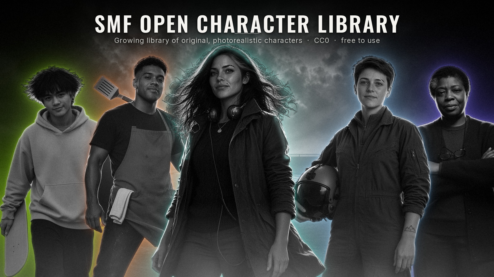

# SMF Open Character Library

A public catalog of original characters you can use as-is or remix. Mobile app coming soon to handle the work for you.

Each character ships as a complete kit: reference stills, a locked identity block, a short story with one on-camera tell, still and image-to-video prompts, a Suno voice prompt with song directions, and a short proof video. The idea is low friction. Open a folder, copy a prompt, start making something.

Created by SMF Works.

## License

Everything in this library is dedicated to the public domain under [CC0 1.0 Universal](LICENSE). You may use the characters and assets for any purpose, including commercial work, with no permission required.

Credit is optional, not required. If you want to credit the source, a simple line is enough:

> Character from the SMF Open Character Library by SMF Works.

SMF Works and the character names are not licensed as trademarks by this waiver. Do not present a character, or this library, as an official SMF Works product or endorsement unless we have agreed to that in writing.

These characters are fictional. They are not portraits of real people.

## Characters

| Character | Hook | Genres | Folder |
| --- | --- | --- | --- |
| [Marisol Vey](marisol-vey/) | A night-ferry radio operator who narrates the harbor. | Noir, moody explainers | `marisol-vey/` |
| [Theo Banks](theo-banks/) | A high-energy street food-truck cook who works a late-night window. | Upbeat promos, product ads | `theo-banks/` |
| [Juniper Hale](juniper-hale/) | A mountain search-and-rescue pilot who flies a light utility helicopter. | Adventure, action, outdoor brands | `juniper-hale/` |
| [Dr. Iris Okafor](iris-okafor/) | A planetarium curator who runs the late show under an aging star projector. | Science, education, homeschool | `iris-okafor/` |
| [Kip Morrow](kip-morrow/) | A skate-shop kid who builds small robots in the back room after closing. | Tech, gaming, Gen Z promos | `kip-morrow/` |
| [Amara Blaze](amara-blaze/) | A Grand Rapids diner server who still drives back to Lake Michigan when the shift is ugly. | Slice-of-life, indie shorts | `amara-blaze/` |

The machine-readable catalog is [`characters.json`](characters.json).

## What's in a kit

Every character folder follows the same layout. See [`docs/kit-format.md`](docs/kit-format.md) for the full specification, [`LESSONS.md`](LESSONS.md) for what we learned building the first kit, and [`CONTRIBUTING.md`](CONTRIBUTING.md) if you want to propose a new character.

In short:

- `README.md` — pronunciation, story, on-camera tell, signature color
- `character-block.md` — the verbatim identity block to paste into every prompt
- `refs/` — nine reference stills (PNG plus lightweight JPG)
- `prompts/` — stills, image-to-video guidance, and Grok Imagine notes
- `voice/suno.md` — voice prompt and four song directions
- `proof/` — a short proof video made from the stills
- `contact-sheet.png` — all nine refs on one page

## How to use a character

1. Open the character folder and read the story and the on-camera tell.
2. Copy the identity block from `character-block.md` into your image or video prompt.
3. Lock the face with the headshot in `refs/01-headshot-front.png` as a reference image.
4. Follow the still or image-to-video prompts. For video, use one action and one camera move per shot, and start from a first-frame still.
5. For music, start from the Suno voice prompt and one of the four song directions.

You can keep a character exactly as written, or change wardrobe, setting, and age as long as you are clear that the result is a variant.

## Status

The catalog has six locked characters. Marisol Vey, Theo Banks, Juniper Hale, Dr. Iris Okafor and Kip Morrow were locked on 22 Nov 2026. Amara Blaze was locked on 23 Nov 2026. Later kits start from the notes in [`LESSONS.md`](LESSONS.md).
