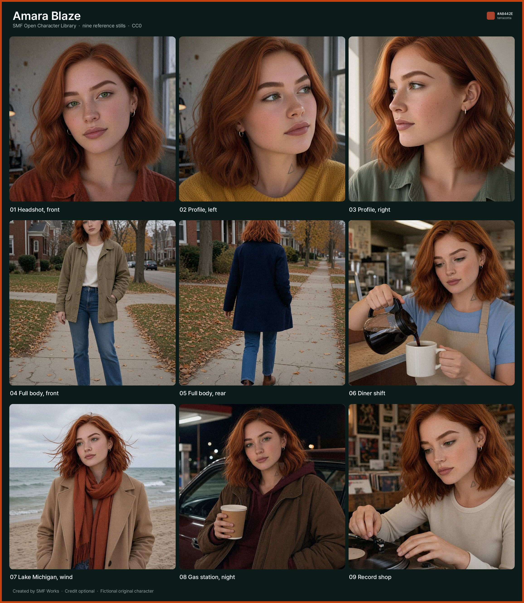

# Amara Blaze

**Pronunciation:** uh-MAR-uh BLAZE

**Age:** 24

**Hook:** A Grand Rapids diner server who still drives back to Lake Michigan when the shift is ugly.

**Genres:** slice-of-life, indie shorts, diner spots, folk-pop

**Signature color:** `#A8442E` (ember rust)

**Tell:** She drops the needle on a record and waits a beat for the first note.

**Status:** locked (23 Nov 2026)

## Story

Amara Blaze works the open-to-two shift at a worn independent diner a few blocks off Division in Grand Rapids, the kind of place with a pie case, a radio that never quite finds the station, and a coffee pot that has been on too long. She grew up in a lakeshore town in West Michigan, came inland for cheap rent and a job that started at five, and she still drives back to the water when the shift is ugly. Her Civic has a cracked dash and a glovebox full of burned CDs. She talks with a warm, slightly nasal Midwest clip, and she remembers regulars' orders before they sit down.

After the last ticket she often ends up at a used record shop on the way home, flipping through the dollar bin with a paper cup of diner coffee gone cold. On quiet Sundays she parks at a Lake Michigan turnout and lets the wind take the smell of fryer oil out of her hair. She will not make a speech about any of that. She will say the walnut pie is better than the cherry, the lake is colder than it looks, and if you wait she will put a fresh pot on.

## Visible locks

1. A small faded healed-ink outline triangle tattoo on her left side of the neck (photo-right in a front view). Hide it in a right profile and in a rear view; do not flip it to the right side of the neck (photo-left in a front view). If the tattoo cannot be placed correctly, hide it rather than flip it. The tattoo-free fallback is a green butterfly hair clip on the left side of her hair; do not invent or move a wrong-side tattoo.
2. Small gold hoop earrings when the ears are visible.
3. Fire-red / bright orange-copper jaw-length wavy hair, not shoulder-length.
4. Vivid natural green eyes.

The front headshot in `refs/01-headshot-front.png` is the identity lock. Use it as the reference image for every later still.

## Wardrobe

Outfit varies; the grey sweater is incidental, not a wardrobe lock. Across the reference set she wears a rust-orange work shirt, a mustard knit, a sage-green button-up, an olive chore coat over a cream tee with jeans and brown lace-up boots, a navy wool coat with jeans and brown boots, a pale-blue tee and tan canvas apron on a diner shift, a camel coat and rust scarf at the lake, a brown jacket over a maroon hoodie at night, and a cream thermal in a record shop.

## Photography

Candid real photography: mixed 35mm documentary and phone-camera looks, practical diner, lake, and shop light, sensor noise, imperfect focus, moderate pores, no beauty sheen, no sparkly catchlights, no lash polish.

## How to use

1. Copy the verbatim identity block from [`character-block.md`](character-block.md).
2. Lock her face with [`refs/01-headshot-front.png`](refs/01-headshot-front.png) as the reference image.
3. Use the ready-made prompts in [`prompts/stills.md`](prompts/stills.md) and the image-to-video rules in [`prompts/image-to-video.md`](prompts/image-to-video.md).
4. For music, start from the voice prompt and one song direction in [`voice/suno.md`](voice/suno.md).

The short proof video is [`proof/amara-blaze-proof.mp4`](proof/amara-blaze-proof.mp4).

## Assets

- Identity block: `character-block.md`
- Stills: `refs/`
- Contact sheet: `contact-sheet.png`
- Prompts: `prompts/`
- Voice: `voice/suno.md`
- Story: `story/story.md`
- Proof: `proof/amara-blaze-proof.mp4`

## Open use

You may use Amara, these stills, the prompts, and the proof video for any purpose, including commercial work, with no permission required. Credit is optional. The kit is dedicated to the public domain under [CC0 1.0](../LICENSE).

Amara Blaze was created by an outside creator who contributed her to the library under CC0; SMF Works developed her reference set, story and proof.

If you want to credit the source, a simple line is enough:

> Amara Blaze, from the SMF Open Character Library.

Do not present Amara as an official spokesperson for SMF Works, and do not treat her as a portrait of a real person. She is a fictional original character.

You can keep her as written, or change the wardrobe or setting.
