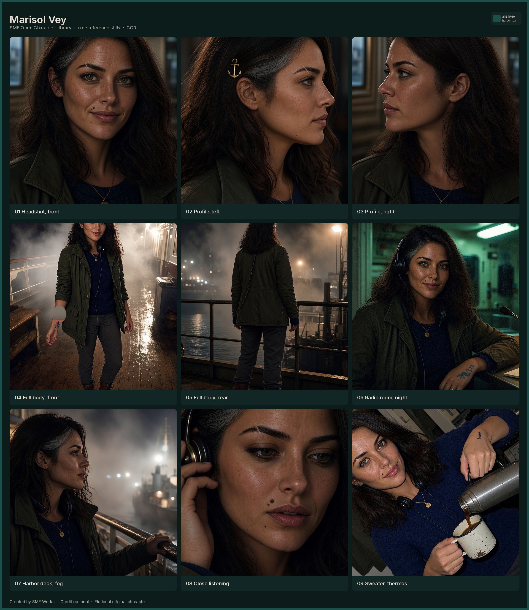

# Marisol Vey

**Pronunciation:** MAIR-ih-sol VAY  
**Age:** mid-30s  
**Hook:** A night-ferry radio operator who narrates the harbor.  
**Genres:** noir, moody explainers, harbor drama, late-night documentary  
**Signature color:** `#1B4F4A` (harbor-bulkhead teal)  
**License:** [CC0 1.0](../LICENSE). Credit is optional. Created by SMF Works.

## Story

Marisol Vey keeps the night watch on the last ferry that still runs the long crossing after midnight. From a narrow radio room above the wheelhouse, she talks the harbor in: foghorns, delayed freighters, the fishermen who only come home when the tide allows it. Her voice is warm tea gone slightly cool, and she never rushes a weather call. On the hour she reads the weather like a promise.

She grew up in a walk-up that faced the docks, learned the channel markers before she learned long division, and took the radio job because she could not sleep anyway. On slow nights she reads the passenger list out loud to the dark water, just so the names do not feel lost. The token on her necklace belonged to her aunt, who ran this same route thirty years ago. Marisol does not talk about that much. She just keeps the channel open.

## On-camera tell

Before she speaks, she taps the ferry-token charm once against her collarbone.

## How to use

1. Copy the verbatim identity block from [`character-block.md`](character-block.md).
2. Lock her face with [`refs/01-headshot-front.png`](refs/01-headshot-front.png) as the reference image.
3. Use the ready-made prompts in [`prompts/stills.md`](prompts/stills.md) and the image-to-video rules in [`prompts/image-to-video.md`](prompts/image-to-video.md).
4. For music, start from the voice prompt and one song direction in [`voice/suno.md`](voice/suno.md).

The short proof video is [`proof/marisol-proof.mp4`](proof/marisol-proof.mp4).

## Open use

You may use Marisol, these stills, the prompts, and the proof video for any purpose, including commercial work, with no permission required. Credit is optional. If you want to credit the source:

> Marisol Vey, from the SMF Open Character Library by SMF Works.

Do not present Marisol as an official spokesperson for SMF Works, and do not treat her as a portrait of a real person. She is a fictional original character.

You can keep her as written, change the wardrobe or setting, or commission SMF Works to produce ads and promos with her (as-is or modified).
