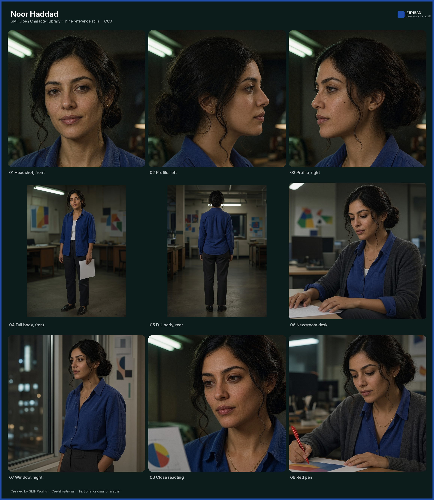

# Noor Haddad

**Pronunciation:** NOOR hah-DAD

**Age:** 30s

**Hook:** A late-shift data journalist who stays until a number makes sense.

**Genres:** business, finance, AI news, numbers explainers

**Signature color:** `#1F4EAD` (newsroom cobalt)

**Tell:** She uncaps a red pen and circles one number on a printout.

**Status:** locked (25 Nov 2026)

## Story

Noor Haddad works the late shift at a regional newsroom, the kind of desk that is still lit when the bullpen has gone home, with a printout, a red felt-tip, and a monitor full of charts no one else wanted to sit with. She came to data journalism because a number, checked twice, can do what a quote sometimes cannot. She stays until the figure makes sense. She talks in a clear, measured alto, and she will not publish a chart she cannot defend.

After midnight she often stands at the office window with her hands in her pockets and looks at the city lights without really seeing them. She will not make a speech about any of that. She will say the axis is wrong, the sample is thin, and if you wait she will circle the one number that matters.

In stills and video, any "number" on a printout or chart must stay abstract or out of focus. Do not introduce readable typography, logos, faces on boards, or stray silhouettes or reflections.

## Visible locks

1. Thick nearly-black hair in a slightly messy low bun at the nape, a soft off-center part slightly toward her left, and loose tendrils at the temples. Not a high bun, and not worn loose.
2. A small dark mole on the upper right cheekbone (photo-left in a front view). Hide it in a left-side view; do not flip it to the left cheek. If the mole cannot be placed correctly, hide it rather than flip it.
3. A thin worn gold chain with no pendant, visible at the collarbone, and tiny plain gold studs in both ears when the ears are visible.

The front headshot in `refs/01-headshot-front.png` is the identity lock. Use it as the reference image for every later still.

## Wardrobe

A slightly rumpled newsroom-cobalt cotton button-down the color of `#1F4EAD` — deep saturated cobalt, not a bright mid-blue and not navy — sleeves rolled to the elbow, over a plain white undershirt; dark charcoal straight trousers; scuffed black leather loafers. At the desk she often wears a faded charcoal cardigan over the cobalt shirt, and a cheap red felt-tip pen is usually nearby. Natural unpainted matte lips; no lipstick, gloss, or balm sheen.

## Photography

Candid real photography: mixed 35mm documentary and phone-camera looks, hard fluorescent tubes and monitor glow, sensor noise, imperfect focus, moderate pores, no beauty sheen, no sparkly catchlights, no lash polish. Backgrounds use blank or abstract charts only: no readable typography, no faces on boards, no logos, and no stray silhouettes or reflections.

## How to use

1. Copy the verbatim identity block from [`character-block.md`](character-block.md).
2. Lock her face with [`refs/01-headshot-front.png`](refs/01-headshot-front.png) as the reference image.
3. Use the ready-made prompts in [`prompts/stills.md`](prompts/stills.md) and the image-to-video rules in [`prompts/image-to-video.md`](prompts/image-to-video.md).
4. For music, start from the voice prompt and one song direction in [`voice/suno.md`](voice/suno.md).

The short proof video is [`proof/noor-haddad-proof.mp4`](proof/noor-haddad-proof.mp4).

## Assets

- Identity block: `character-block.md`
- Stills: `refs/`
- Contact sheet: `contact-sheet.png`
- Prompts: `prompts/`
- Voice: `voice/suno.md`
- Story: `story/story.md`
- Proof: `proof/noor-haddad-proof.mp4`

## Open use

You may use Noor, these stills, the prompts, and the proof video for any purpose, including commercial work, with no permission required. Credit is optional. The kit is dedicated to the public domain under [CC0 1.0](../LICENSE).

Noor Haddad was created by SMF Works.

If you want to credit the source, a simple line is enough:

> Noor Haddad, from the SMF Open Character Library.

Do not present Noor as an official spokesperson for SMF Works, and do not treat her as a portrait of a real person. She is a fictional original character.

You can keep her as written, or change the wardrobe or setting.
