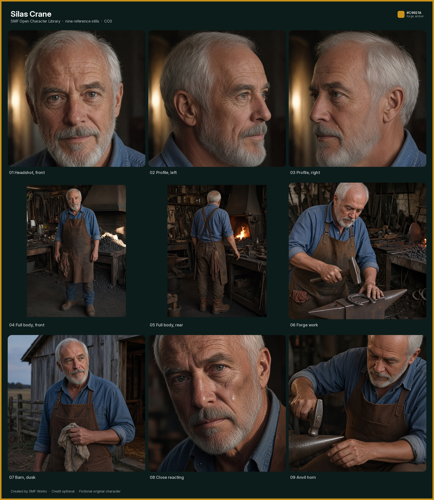

# Silas Crane

**Pronunciation:** SY-lus KRAYN

**Age:** 60s

**Hook:** A Blue Ridge farrier who still runs a coal forge behind his barn.

**Genres:** country, Americana, craft, heritage

**Signature color:** `#C9921A` (forge amber)

**Tell:** He gives the anvil horn two light hammer taps before he speaks.

**Status:** locked (25 Nov 2026)

## Story

Silas Crane works a coal forge behind his barn in the Blue Ridge, the kind of shop where the floor is packed dirt and scale, the anvil sits in a ring of scorch marks, and the radio, when it is on, is turned down low. Neighbors still trailer horses to him for shoes, and he will repair a broken hinge or a wagon iron if you leave it by the door. He learned the work from his father and never saw a reason to switch the fire to propane. He talks in an unhurried Appalachian baritone, and he does not fill a silence just to be polite.

In the late afternoon he often stands in the barn door with a rag in his hand and watches the light go off the ridge. He will not make a speech about any of that. He will say the shoe is tight enough, the coal is burning clean, and if you wait he will finish the last tap.

## Visible locks

1. Thinning close-cropped silver-white hair, sparse on top with the scalp visible, no hat, ending well above the collar from behind. Keep it sparse like the locked front headshot; do not fill it into a full white cap. A short silver-white beard with a darker steel-gray streak only through the chin and the center of the mustache.
2. A short pale nick-scar on the right cheek just above the beard line (photo-left in a front view). Hide it in a left-side view; do not flip it to the left cheek. If the scar cannot be placed correctly, hide it rather than flip it.
3. A faded pale thumbprint burn scar on the outer right forearm just below the rolled sleeve only — in a front view that arm is photo-left; in a rear view it is photo-right. Never place it on the left arm. If the burn cannot be placed on the right forearm, hide it rather than flip it.

The front headshot in `refs/01-headshot-front.png` is the identity lock. Use it as the reference image for every later still.

## Wardrobe

A worn brown leather farrier's apron, darkened and scorched at the belly, over a faded indigo chambray work shirt with the sleeves rolled to mid-forearm; heavy dark-brown canvas work pants; scuffed chestnut leather work boots. A faded rust shop rag often hangs from the apron pocket. No logos or printed typography on clothes or tools.

## Photography

Candid real photography: mixed 35mm documentary and phone-camera looks, harsh uneven practical forge and barn light, soot, sweat, a messy working shop, sensor noise, imperfect focus, moderate pores, no catalog sheen, no beauty retouching, no CGI.

## How to use

1. Copy the verbatim identity block from [`character-block.md`](character-block.md).
2. Lock his face with [`refs/01-headshot-front.png`](refs/01-headshot-front.png) as the reference image.
3. Use the ready-made prompts in [`prompts/stills.md`](prompts/stills.md) and the image-to-video rules in [`prompts/image-to-video.md`](prompts/image-to-video.md).
4. For music, start from the voice prompt and one song direction in [`voice/suno.md`](voice/suno.md).

The short proof video is [`proof/silas-crane-proof.mp4`](proof/silas-crane-proof.mp4).

## Assets

- Identity block: `character-block.md`
- Stills: `refs/`
- Contact sheet: `contact-sheet.png`
- Prompts: `prompts/`
- Voice: `voice/suno.md`
- Story: `story/story.md`
- Proof: `proof/silas-crane-proof.mp4`

## Open use

You may use Silas, these stills, the prompts, and the proof video for any purpose, including commercial work, with no permission required. Credit is optional. The kit is dedicated to the public domain under [CC0 1.0](../LICENSE).

Silas Crane was created by SMF Works.

If you want to credit the source, a simple line is enough:

> Silas Crane, from the SMF Open Character Library.

Do not present Silas as an official spokesperson for SMF Works, and do not treat him as a portrait of a real person. He is a fictional original character.

You can keep him as written, or change the wardrobe or setting.
